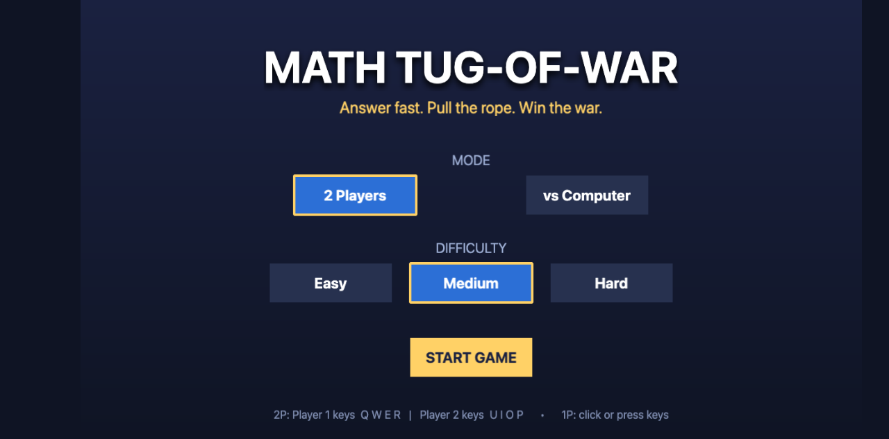
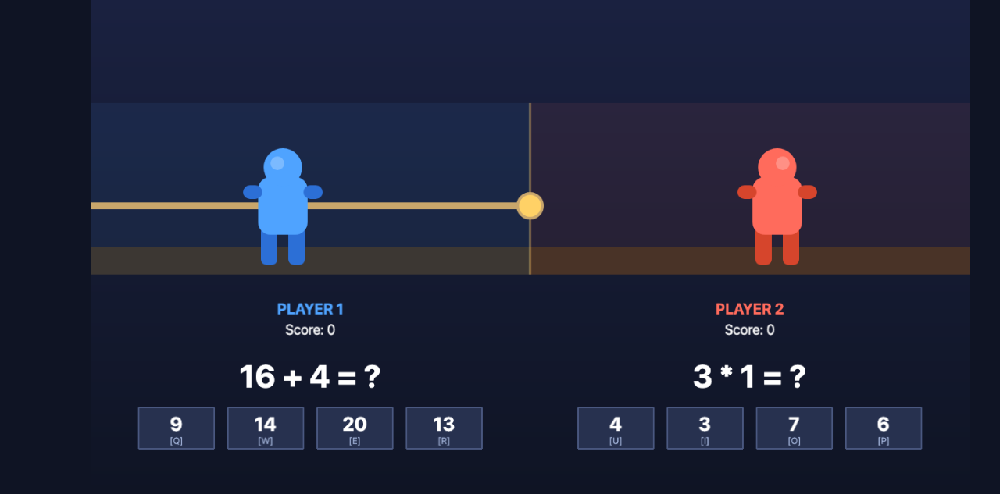
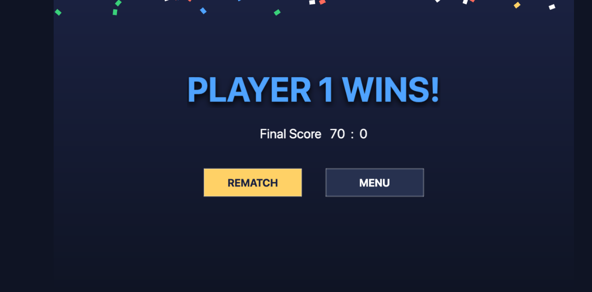

# Math Tug-of-War 🪢➕

A polished 2D arcade browser game where two players compete by answering math
questions. Every correct answer pulls the rope toward your side — first to drag
your opponent past the losing boundary wins.

Built with **Phaser 3**, **TypeScript**, and **Vite**.



## Features

- **Two-player local** — Player 1 on `Q W E R`, Player 2 on `U I O P`, same keyboard.
- **Single-player vs AI** — the computer answers with difficulty-scaled speed and accuracy.
- **Difficulty settings** — Easy (addition/subtraction), Medium & Hard (adds multiplication, bigger numbers, faster/sharper AI).
- **Multiple-choice answers** — pick by key or click; four options, always one correct.
- **Tug-of-war rope physics** — correct answers pull a shared rope; it's clamped so it can never overshoot a win.
- **Scoring with combo streaks** — consecutive correct answers earn bonus points.
- **Countdown, victory animation, confetti, rematch & menu.**

> **Note on visuals:** this is the playable MVP. Characters are currently clean
> procedurally-drawn placeholders (no external assets required to run). Polished
> character art, animation, and juice are the focus of the next milestone — the
> gameplay, input, AI, scoring, and win logic are complete and verified.

## Gameplay





## Getting started

Requires **Node 18+** and a package manager (examples use `pnpm`; `npm` works too).

```bash
pnpm install      # install dependencies
pnpm dev          # start the dev server (http://localhost:5173)
pnpm build        # type-check + production build to dist/
pnpm preview      # serve the production build locally
pnpm test         # run the unit test suite
pnpm typecheck    # type-check only
```

Open the dev URL in a browser, pick a mode and difficulty, and hit **Start Game**.

### Controls

| | Player 1 (left / blue) | Player 2 (right / red) |
|---|---|---|
| Answer buttons | `Q` `W` `E` `R` | `U` `I` `O` `P` |
| Or | click a button | click a button |

In single-player mode, Player 2 is the AI; you play the left side.

## Project structure

```
src/
  core/            # pure, framework-free game logic (fully unit-tested)
    types.ts
    difficulty.ts
    mathProblems.ts    # problem generation, validation, answer choices
    ropeEngine.ts      # rope position, pulls, win detection
    aiOpponent.ts      # AI timing + accuracy decisions
    scoring.ts         # score + combo streaks
  scenes/          # Phaser scenes (Boot, Menu, Game, GameOver)
  config.ts        # dimensions, palette, fonts
  main.ts          # Phaser game bootstrap
tests/             # vitest unit tests mirroring src/core
docs/screenshots/  # README images
```

The **core logic is deliberately separated from Phaser** so it can be unit
tested in Node without a browser, and reused if the rendering layer ever changes.

## Testing

Automated tests (vitest) cover the required areas and more:

- **Math generation** — answers always match the true result; subtraction never
  goes negative; operand caps and allowed operations respected per difficulty;
  fuzzed across thousands of samples.
- **Answer validation** — exact-match accept/reject, rejects `NaN`/`Infinity`.
- **Answer choices** — correct answer always included, unique, non-negative,
  deterministic under a seeded RNG.
- **Rope movement** — direction, clamping at boundaries, purity, multipliers.
- **Win conditions** — winner declared exactly at the boundary, not before.
- **AI opponent** — think-time bounds, accuracy roll, wrong-answer generation.
- **Scoring** — base points, capped combo bonus, streak reset, side independence.

```bash
pnpm test
```

## Roadmap

- [x] Playable MVP: full gameplay loop, 2P + AI, difficulty, countdown, scoring, win, rematch
- [x] Automated tests for math, validation, rope, win conditions, AI, scoring
- [ ] Polished character art + animations (idle, pull, strain, win/lose)
- [ ] Sound effects and music
- [ ] Juicy feedback: screen shake, particles, rope tension visuals
- [ ] Mobile / touch layout
- [ ] itch.io release build

## License

MIT
